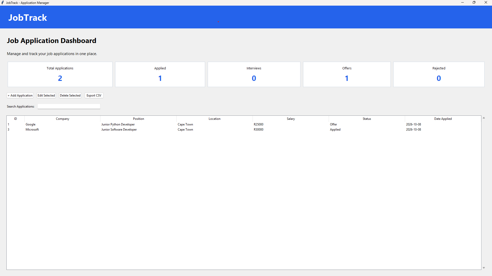

# JobTrack - Job Application Management System

A Python desktop application designed to help users
organize, manage, and track their job applications.

JobTrack provides a graphical interface for managing
applications, monitoring their progress, searching
records, and exporting data.

## Features

- Add new job applications
- View all saved applications
- Edit application statuses
- Delete applications with confirmation
- Search by company, position, or location
- Dashboard with application statistics
- Export application records to CSV
- Validate required fields and application dates
- Automatically save data using SQLite
- Automated database tests

## Technologies Used

- Python 3.12
- Tkinter - Desktop graphical interface
- SQLite - Relational database
- SQL - Database operations
- unittest - Automated testing
- Git and GitHub - Version control

## Project Structure

```text
JobTrack/
├── main.py
├── gui.py
├── database.py
├── test_database.py
├── README.md
└── .gitignore
```

The SQLite database is created automatically
when the application starts.

## Installation

### Requirements

- Python 3.12 or newer
- Tkinter support

No third-party Python packages are required.

### Steps

1. Clone the repository:

   git clone YOUR_REPOSITORY_URL

2. Navigate into the project directory:

   cd JobTrack

3. Run the application:

   python main.py

## Running Automated Tests

Run all database tests using:

    python -m unittest discover -v

The tests use a temporary in-memory SQLite database
and do not modify the application's stored records.

## How to Use

1. Launch the application.
2. Click "Add Application" to enter job details.
3. Save the application to the database.
4. View applications in the dashboard.
5. Select a record to edit its status or delete it.
6. Use the search bar to filter applications.
7. Export application records using "Export CSV".

## Database Design

The application uses an SQLite database containing
an applications table.

| Column | Data Type | Description |
|--------|-----------|-------------|
| id | INTEGER | Primary key |
| company | TEXT | Company name |
| position | TEXT | Job title |
| location | TEXT | Job location |
| salary | TEXT | Salary information |
| status | TEXT | Application status |
| date_applied | TEXT | Application date |
| notes | TEXT | Additional notes |

## Automated Testing

The project includes five database tests covering:

- Creating applications
- Reading application records
- Updating application statuses
- Deleting applications
- Handling an empty database

## Future Improvements

- Edit all application details
- Application status filtering
- Interview reminders
- Advanced analytics and charts
- Improved interface styling
- Additional automated tests

## Author

Developed as a Python software engineering
portfolio project.

## Application Screenshot


